# A tour of the new app

MWA 0.10.0 opens the new app by default, on the computer and on a phone. This guide walks through each screen: what it
is for and how to do the main things. The code lives in `web/src/v2/`.

The pictures were taken with `node scripts/v2-screenshots.mjs` against the app's built-in example day (fixture mode),
so every name, address and event in them is invented. That is also why each one shows a small "simulated" badge; your
own copy does not show it.

If you want the old screens back, see [The classic app](#the-classic-app) at the end.

## The frame around every screen

- **Tabs**: Today, Calendar, Important and Projects. On a phone they sit at the bottom; on a computer, across the top.
- **The Ask bar** ("Ask, or hand over a job") sits above the tabs on a phone and is the **Ask** button on a computer.
  It opens the Ask sheet from any screen. The mic next to it is voice input: tap or hold it and talk. The words go into
  the box and are never sent until you press Send.
- **The status pill** (for example "Working on 1 thing", or "2 waiting for you") says what your helper is busy with.
  Tap it to open the working sheet: each job, how it is going, and Stop / Start over where that makes sense.
- **The person button** (top right) opens Settings.

## Today

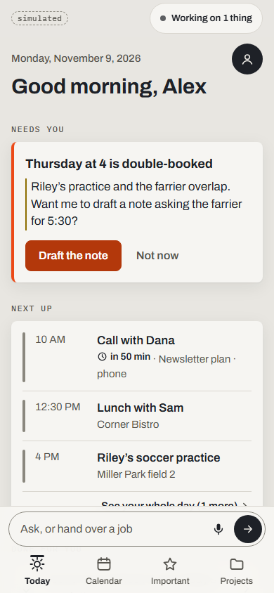 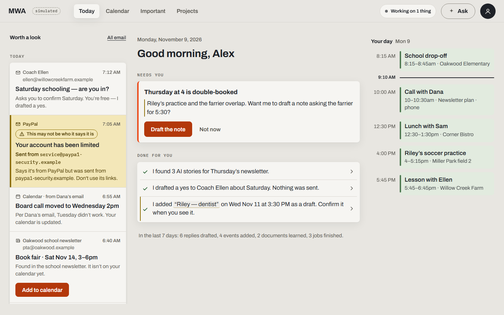

Your day in one place. From the top:

- **Needs you**: things only you can decide, such as a double booking ("Draft the note" / "Not now"), an approval
  ("Review"), or a setup card when a job needs a password or key.
- **Next up**: your next calendar events, with "See your whole day".
- **Done for you**: what the helper did since you last looked ("I drafted a yes to Coach Ellen. Nothing was sent.").
  Tap a line to see the detail.
- A morning check-in and an evening wrap appear at the right time of day and can be dismissed for the day.

On a wide screen Today has three columns: "Worth a look" (from Important) on the left, the day in the middle, and your
calendar on the right.

## Asking for something

Type in the Ask bar (or talk). While you type, the sheet suggests which project the ask belongs to ("To: Family &
school · suggested"); tap **Change** to pick another one.

What happens next depends on the size of the ask:

- **A quick question** is answered right there, live.
- **A big ask** (for example "learn everything from these two PDFs") comes back as a plan card with two choices,
  "Do it now" or "In the background", each with a rough cost and a ready time. **Or narrow it…** offers smaller
  versions. **Details** lets you set "Stop if it costs more than $…" for each choice.
- **Background work** becomes a job: "I'll let you know · ready around …". Follow it from the status pill.

You can attach files with **Add files**. If you are offline, the ask waits on the device and is sent when you are back.

Most items in the app (an email, an event, a job, an Important item) also have **Ask about this**, which asks with that
item as the subject and shows the answer in place.

## Projects and conversations

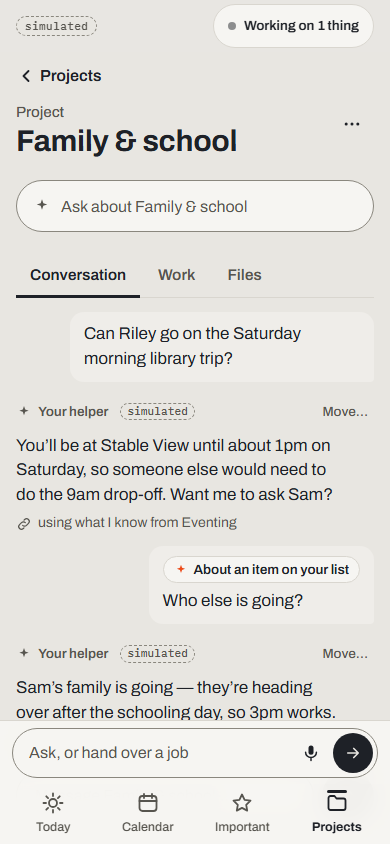 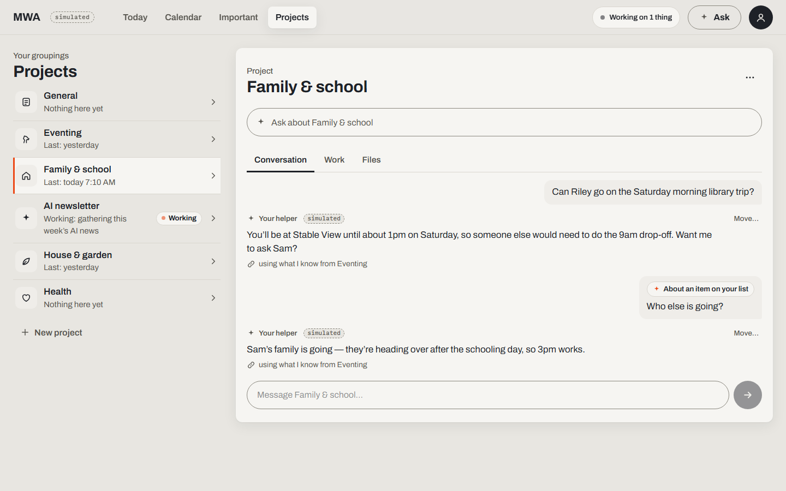

Projects keep related work together; each has one running conversation. The list shows what each project is doing
("Working: gathering this week's AI news") and archived projects under "Archived". Inside a project:

- **Conversation**: the thread with your helper. When an answer used something learned in another project, it says so
  ("using what I know from Eventing"). Each message has **Move…** to file it under another project, with Undo.
  While an answer is running you can **Stop** it or **Add to it**.
- **Work**: the jobs for this project, with their status and actions.
- **Files**: files added to this project.
- The **⋯** menu renames or archives the project. **Ask about <project>** asks inside it.

## Approvals ("Needs your OK")

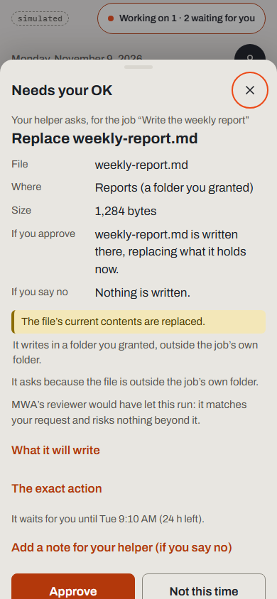 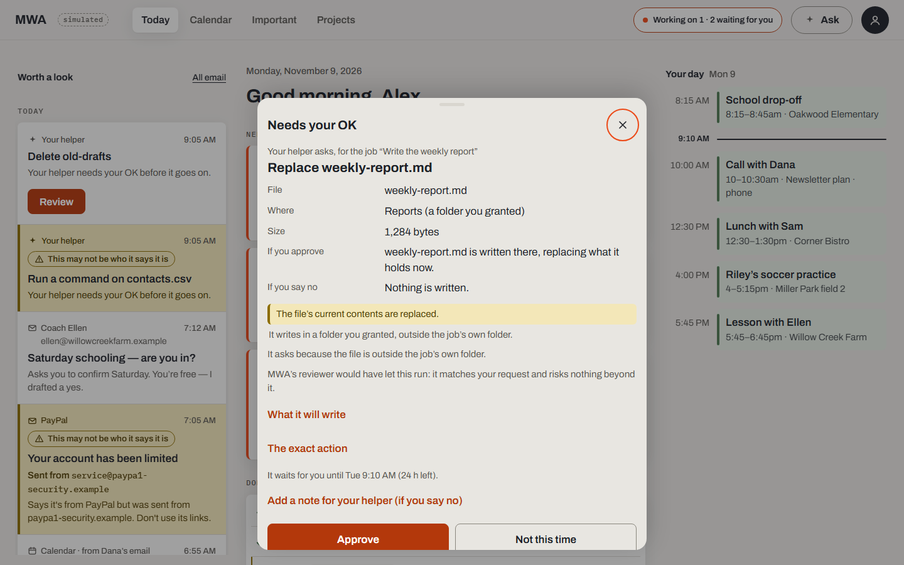

Some actions wait for you: writing over a file in a folder you granted, running a command that reaches outside its
own folder, deleting something, sending data to the network. They show up in Today's **Needs you**, in the status
pill ("2 waiting for you") and, if you turned them on, as a notification.

Each approval says, in plain words, which job asked, what it will touch, what happens if you approve and if you say
no, why it asked, and what MWA's own reviewer thought. **What it will write** and **The exact action** show the exact
text or command on demand. Then:

- **Approve** runs it. A risky one (proposed after reading outside content, deletes something, reaches outside its
  folder) asks **Are you sure?** first, with the reasons. The server checks this too, so a second tap can't skip it.
- **Not this time** says no. **Add a note for your helper** tells it why.
- An approval does not wait forever: "It waits for you until …".

An action that was traced to a suspicious message is never offered as a plain Needs-you card. It only shows behind
Important's warning, so it cannot be approved by accident from a list.

## Important ("Worth a look")

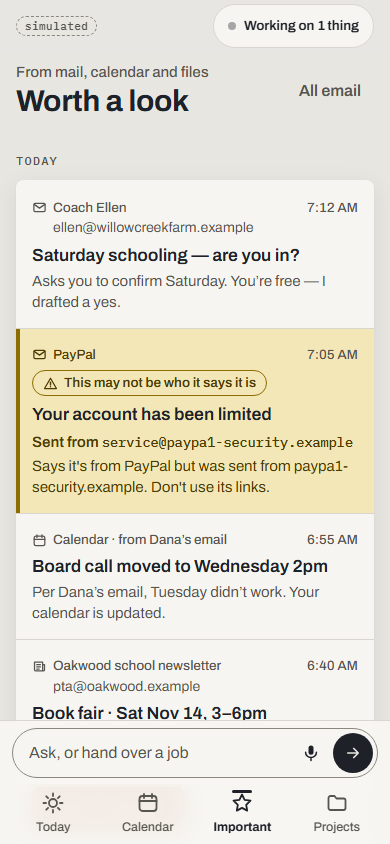 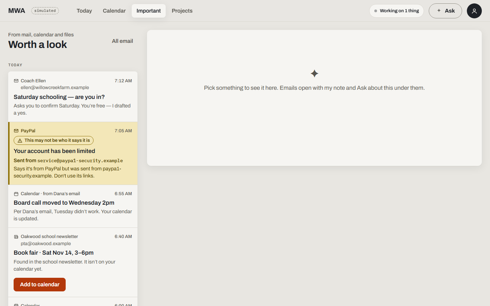

What from your mail, calendar and files is worth your attention today, with a line on why. Things to know:

- **Phishing caution**: a message that may not be who it says it is gets a yellow "This may not be who it says it is"
  band, and the real sending address is always shown on its own line. You can't ask the helper to act on it.
- Open an item to read it, **Mark handled**, **Not important** (and say why, so it learns), **Open in Calendar**, or
  **Ask about this**.
- **Show them** lists what was skipped; **Your rules** shows the standing rules for what counts as important.
- **All email** opens the mail list. The reader shows sanitised text, warns when a reply would go to a different
  address, and can **Draft a reply**. MWA saves drafts; it never sends mail.

## Calendar

A day strip and week view of your connected calendars. Events the helper added are drafts until you confirm them.
Double bookings are listed with a suggested fix ("Draft the note" / "Not now"). If no calendar is connected yet, the
screen offers **Connect a calendar**.

## Settings

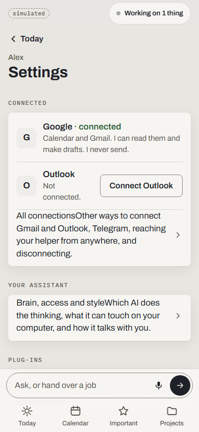 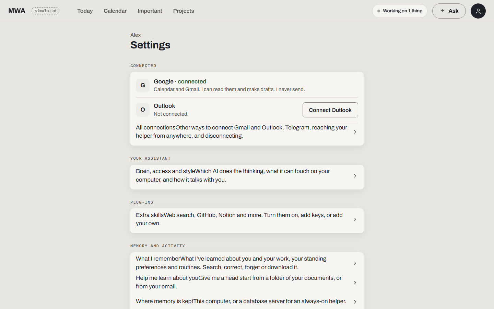

Everything the classic Settings did is here. The main sections:

- **Connected**: Google and Outlook at a glance, and **All connections**.
- **Your assistant** › Brain, access and style: which AI does the thinking (and which one draws pictures), how much it
  can touch on your computer (the access level and the folders you grant), and how it talks with you.
- **Plug-ins** › Extra skills.
- **Memory and activity**: What I remember, Help me learn about you, Where memory is kept, Activity, and spending
  this month.
- **This device** (install the app on a phone), **Notifications**, **Voice**, **Devices** (pair a phone, rename or
  remove one), **Your rules**, **Your helper** (names and time zone), **What I keep up to date**, **Saved logins**
  (names only, never a password), **Look** (light, dark, auto) and **About**.

On a paired phone some of these are read-only: changes that touch the computer (keys, folders, plug-ins) are made on
the computer.

### Connections

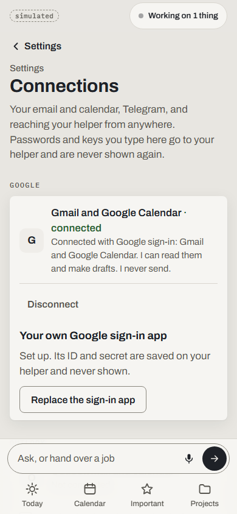 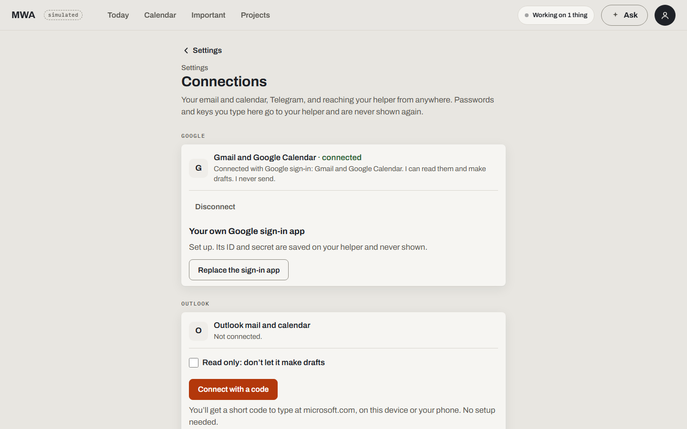

- **Gmail and Google Calendar**: sign in with Google, or **Use an app password** for Gmail. Signing in with Google
  needs your own Google sign-in app (a one-time setup on this page; its ID and secret are saved on your helper and
  never shown again).
- **Outlook**: **Connect with a code** gives you a short code to type at microsoft.com, on this device or your phone.
  Some work or school accounts need your own Microsoft app first; the page walks you through it.
- **Telegram**: paste a bot token to talk to your helper from Telegram.
- **Tailscale**: reach your helper from your phone anywhere, privately.
- Each connection can be disconnected. A sign-in that is still waiting can be cancelled.

Passwords and keys typed here go to your helper and are never shown again. More detail:
[connect-email.md](connect-email.md) and [local-access.md](local-access.md).

### Plug-ins

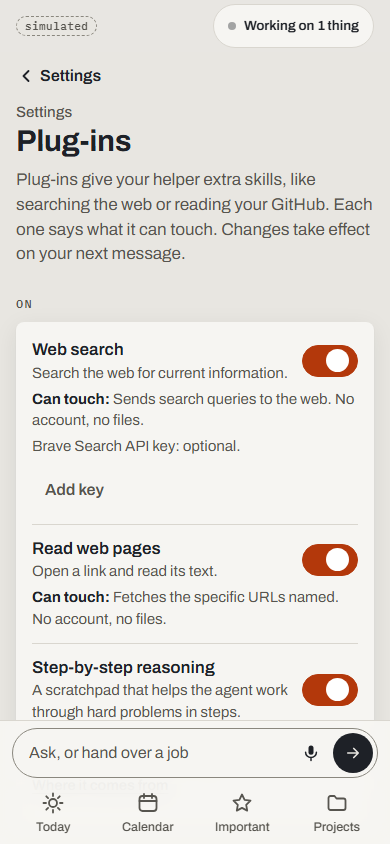 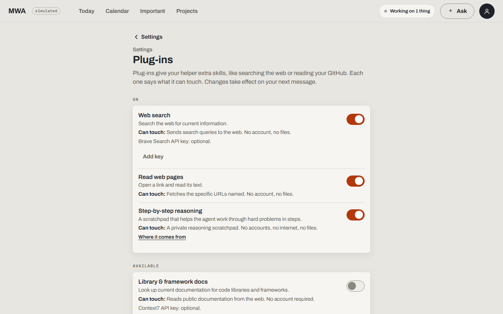

Plug-ins (MCP servers) give the helper extra skills such as web search or reading GitHub. Each one says what it can
touch. You can:

- turn a plug-in on or off (changes apply from your next message);
- **Add key** for one that needs an API key (a saved key is never shown again; **Clear saved key** removes it);
- **Add from npm**: type a package name and press **Review**. A safety review reads it first (up to a minute), shows
  its verdict, and nothing is installed until you approve. Plug-ins you added yourself can be removed.

This page is also at `?view=plugins`.

### What I remember

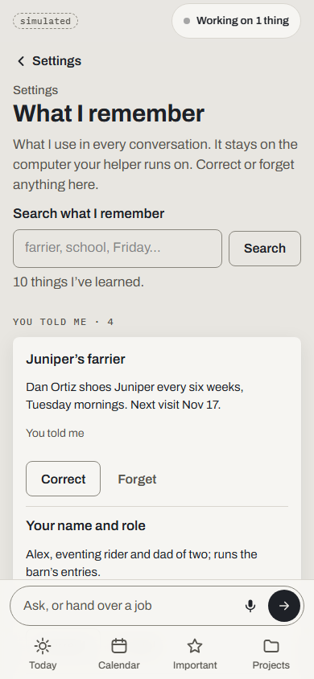 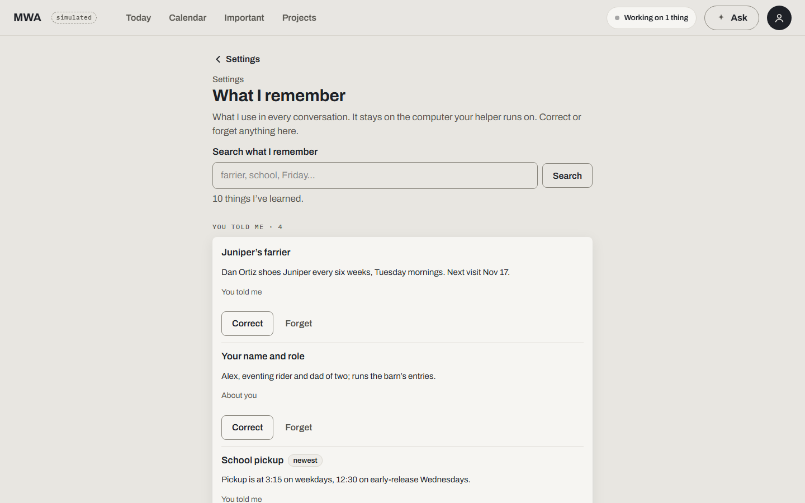

What your helper has learned about you and your work, grouped by where it came from ("You told me", "About you", from
email, from files). It stays on the computer your helper runs on. You can:

- **Search** it;
- **Correct** a fact (the whole fact is kept, with your correction) or **Forget** it;
- see the rules it follows in every task, and promote, retire or remove them;
- **Download everything**.

Next to it: **Activity** (what it did, with **Show more**) and **Spending** (cost by day, also as a table).

### Help me learn about you, and Where memory is kept

- **Help me learn about you** gives the helper a head start: pick a folder of your documents and look over the notes
  it made before saving them, or **Get to know me** from your inbox (it says what it may cost first). Notes from
  files and email stay marked as such. The helper's own data folders are refused.
- **Where memory is kept**: this computer, or a database server for an always-on helper. Changes take effect when
  the helper restarts.

## Getting set up

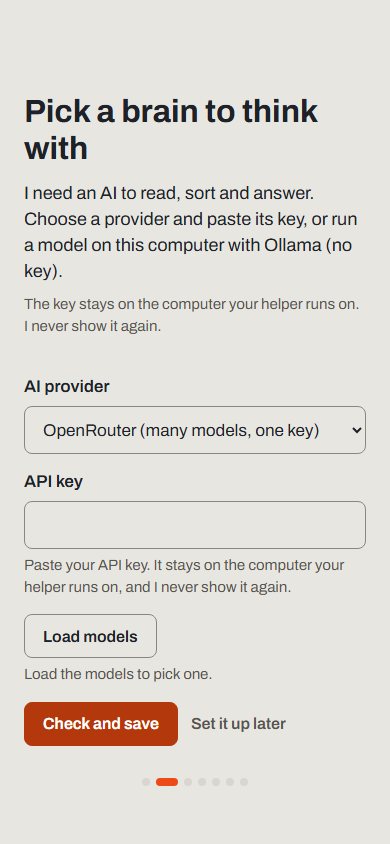 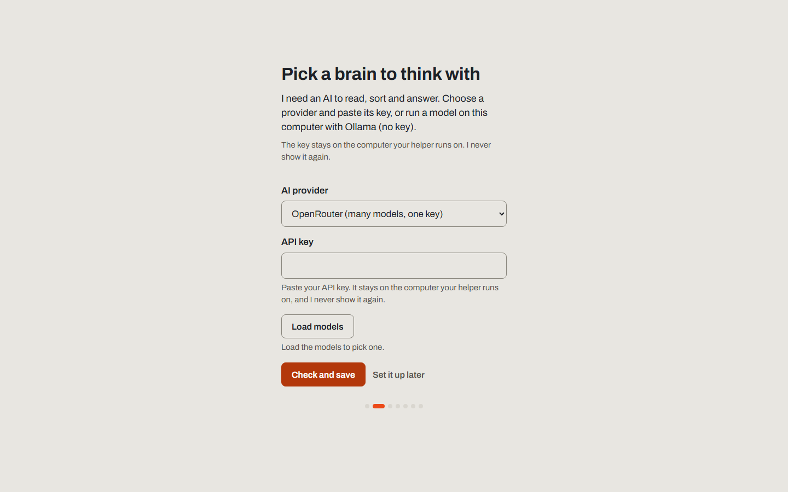

On a new computer the welcome starts with **Pick a brain to think with**: choose an AI provider and paste its key (or
run a local model with Ollama, no key), **Load models**, then **Check and save**. The key stays on the computer and is
not shown again. Then **How much can it touch?** (the access level), your names, connecting calendar and email, and
putting MWA on your phone.

If the brain stops working later (for example, a key was removed), every screen shows a bar saying what is missing,
with **Fix it**.

To go through the welcome again: Settings › About › **Start the welcome again**.

## On your phone

- Pair a phone from the computer: Settings › Devices › **Pair a new device** shows a QR code. Point the phone's camera
  at it and tap Pair. Each phone gets its own access, which you can remove later.
- Install it from Settings › This device to get an app icon, offline use and notifications. Notifications never
  carry personal content; they only say that something is waiting, and quiet hours are respected.
- To reach your helper away from home, use Tailscale (see [Private access](deployment.md#private-access-tailscale) and
  the [onboarding and pairing walkthrough](onboarding-and-pairing.html)) or the hosted address if you run it on a
  server (see [deployment.md](deployment.md)). A phone needs the https address to install the app and get
  notifications.

## The classic app

The classic app is kept for one more release. Open Settings › About › **Use the classic app**: it is remembered on
that device until you choose **Back to the new app**, a link the classic app shows at the top of every screen. Adding
`?ui=v1` to the address opens the classic app for that one visit only.
